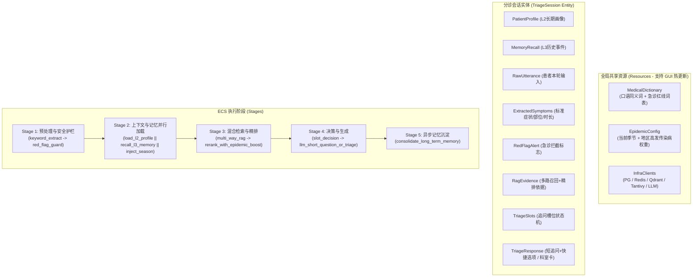

# 01. 总体架构、REDox 调研与 ECS 设计

## 1. 项目定位与技术栈总览

本项目旨在构建一套面向医院高并发场景的**智能医疗分诊与知识库系统**，实现全栈 Rust 化开发（线上高并发服务 + 纯 Rust 数据管线 + Tauri 2.0 桌面 GUI 工具箱），前端面向患者提供微信小程序入口。

| 模块 | Crate / 目录 | 技术栈 | 核心职责 |
| :--- | :--- | :--- | :--- |
| **核心领域与 ECS 引擎** | `crates/medical-core` | Rust + `bevy_ecs` + `aho-corasick` + `jieba-rs` | 领域模型、ECS 分诊流水线、急诊红线拦截、三层记忆结构、短追问槽位状态机 |
| **纯 Rust 数据管线** | `crates/medical-pipeline` | Rust + `rayon` + `tokio` + `sonic-rs` + `calamine` + `fastembed-rs` | 海量医学书籍解析切块、并发向量化、Excel/JSON 病历脱敏导入 |
| **高并发线上服务** | `crates/medical-server` | Rust + `axum` + `sqlx` + `redis` + `qdrant-client` + `tantivy` | 微信小程序鉴权、对外 Open API / OpenAI 兼容网关、多模型 API 路由容灾、SSE 流式分诊、限流降级 |
| **桌面 GUI 工具箱** | `crates/medical-studio` | **Tauri 2.0** (Rust 后端 + Vue3/React 前端) | 知识库导入、病人数据导入脱敏、模型与 API 网关配置、季节流行病配置、词典管理、ECS 白盒调试台 |
| **患者端小程序** | `miniapp/` | 微信小程序（原生 / UniApp） | 隐私授权、极简短追问对话流、快捷选项按钮、科室推荐卡片 |

---

## 2. `CAPCOM-TD-OSS/REDox` 调研与集成评估

### 2.1 调研结论
经核实，[`CAPCOM-TD-OSS/REDox`](https://github.com/CAPCOM-TD-OSS/REDox.git) 是 Capcom 技术研发部开源的**高性能结构化数据引擎**（属于其下一代 REX 引擎技术栈），但需注意：
- **开发语言与运行时**：**C# / .NET（要求 .NET 10+）**，并非 Rust 库。
- **核心设计亮点**：采用扁平化 64-bit Token 结构替代传统深层 DOM 对象树，大幅降低内存分配与 GC 停顿，支持超大 JSON 文件的并行反序列化与原位（In-Place）查询修改。

### 2.2 能否结合本项目开发？
- **不建议直接引入代码依赖**：强行在 Rust 中通过 FFI / NativeAOT 桥接 .NET 10 运行时会带来巨大的跨语言内存拷贝开销、打包体积膨胀和部署复杂度，破坏全栈 Rust 的性能与单二进制交付优势。
- **强烈建议吸收其核心思想，并在 Rust 生态中采用原生平替**：
  1. **替代 REDox 的扁平 Token / 并行 JSON 解析**：使用 **`sonic-rs`**（或 `simd-json`），利用 SIMD 指令集与懒解析（Lazy Parsing）直接按路径提取超大医学 JSON/JSONL 数据集，避免构建完整 DOM 树。
  2. **替代高频配置/知识索引的零开销加载**：使用 **`rkyv`** 实现零拷贝（Zero-Copy）二进制序列化，配合 `mmap` 将百万级症状词典或静态知识索引直接映射入内存。
  3. **数据导向设计（DOD）**：与 REDox 同源的数据导向理念，直接落脚到本项目的 **ECS 架构** 上。

---

## 3. ECS（Entity-Component-System）架构设计

本项目引入独立的 **`bevy_ecs`**（仅引入 ECS 调度器，不引入游戏渲染引擎），将“医疗分诊推理”与“数据管线批处理”均抽象为数据与逻辑彻底解耦的 ECS 模型。

### 3.1 为什么医疗分诊非常适合 ECS？
1. **逻辑高度解耦**：急诊红线拦截、关键词识别、长期记忆召回、季节流行病加权、RAG 检索、短追问生成各自为独立 `System`，可按需热插拔或调整执行顺序。
2. **天然支持并行调度**：无数据依赖的 `System`（如“长期记忆召回”与“季节上下文加载”、“BM25 检索”与“向量检索”）可由 ECS 调度器自动并行执行。
3. **极佳的白盒可观测性**：在 Tauri 桌面调试台中，只需读取一个分诊 `Entity` 挂载的所有 `Component`，即可完整透视分诊每一步的中间状态，方便医生与研发排错。

### 3.2 核心 ECS 建模

### 3.3 关键组件（Components）定义规划
- `PatientIdentity`: 匿名 `patient_id`（由微信 `OpenID` 单向哈希映射）。
- `PatientProfile`: 年龄段、性别、孕产状态、慢病列表、过敏史、长期用药（L2 长期记忆）。
- `SessionMemory`: 本次会话历史轮次 + 召回的相关历史就诊事件摘要（L1 + L3）。
- `ExtractedSymptoms`: 经 `aho-corasick` 与语义抽取标准化后的医学实体列表。
- `RedFlagAlert`: 枚举 `None | Urgent | Emergency120`；若触发 `Emergency120`，后续 AI 阶段通过 ECS `RunCondition` 直接短路跳过，毫秒级返回急救指引。
- `TriageSlots`: 记录当前已收集与缺失的临床槽位（主诉、持续时间、体温/体征、伴随症状、接触史），并严格限制 `max_turns <= 4`。
- `TriageResponse`: 结构化输出（若继续追问：问题正文 `<= 30字` + `2~4` 个快捷选项按钮；若结束分诊：推荐科室、紧急等级 1~4 级、引用医学依据 ID）。

---

## 4. 高并发与云端部署策略

- **ECS World 生命周期**：线上 `medical-server` 不维护全局单一巨型 World（避免跨请求锁竞争），而是采用 **Per-Request / Pooled World**（每次请求或每个活跃会话轻量级复用 ECS `World` + 共享不可变 `Arc<Resources>`），保证 `Axum` 高并发下无锁高吞吐。
- **流式响应（SSE）**：Stage 4 的 LLM 输出通过 `tokio::mpsc` 通道实时推流给微信小程序，避免连接超时。
- **降级兜底**：当 LLM API 超时或队列满载时，ECS 自动切换到 `fallback_rule_triage_system`，直接基于 `ExtractedSymptoms + RagEvidence` 输出科室推荐。
